# Chalice of the King

A real-time multiplayer game of deception, deduction and survival, set at the King's table.

Some goblets are holy. Some are poisoned. Drink, or offer the cup to someone else, and outlast everyone in the royal court.

**Live:** [chalice-of-the-king.vercel.app](https://chalice-of-the-king.vercel.app/)

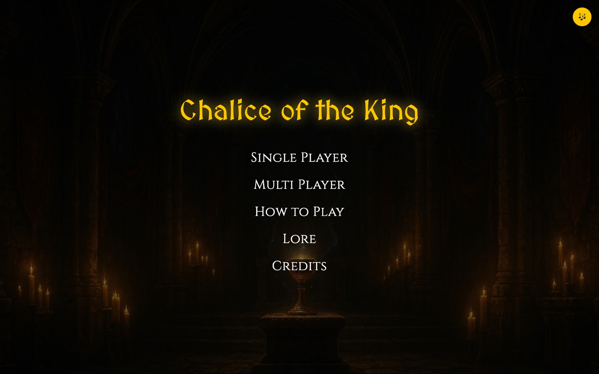

## How It Works

1. **The King announces the round.** Everyone learns how many goblets are poisoned and how many are holy, but not their order.
2. **On your turn, choose:**
   - **Drink:** take the goblet yourself. If it's holy you survive and keep your turn. If it's poisoned you lose a life and the turn passes.
   - **Offer:** force another player to drink. Whatever's inside, your turn ends.
3. **Use artifacts.** Items let you peek at goblets, flip poison to holy, chain opponents, steal items and more.
4. **Survive the rounds.** When a player loses all their lives, a new round starts with new goblets and items. The highest score after the final round wins.

Play solo against the AI, or with up to 4 players in real-time multiplayer with optional voice chat.

## Screenshots

| Round announcement | Your turn |
| :---: | :---: |
| 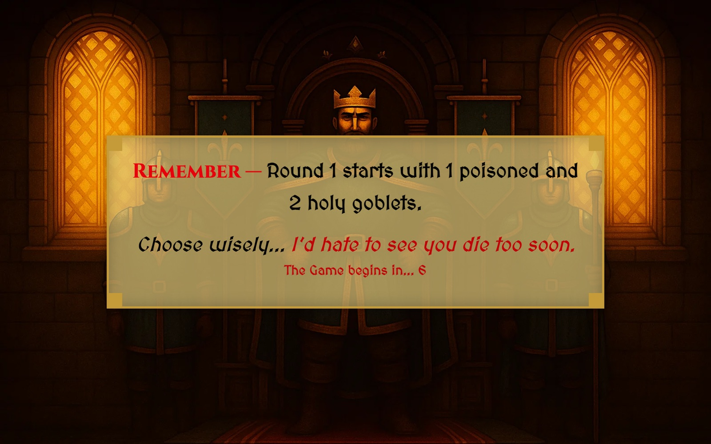 | 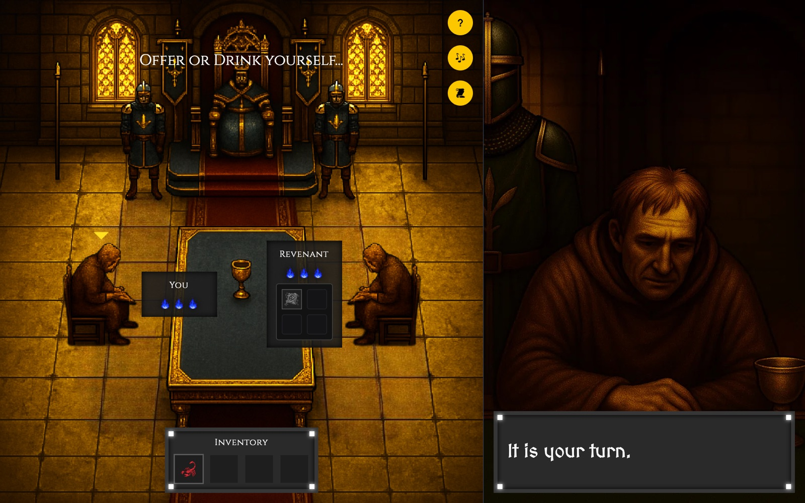 |
| **Offering the goblet** | **Poisoned** |
| 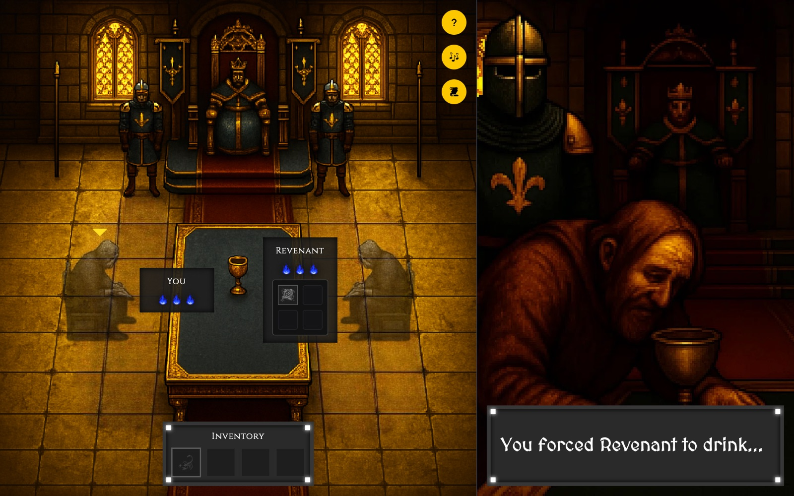 | 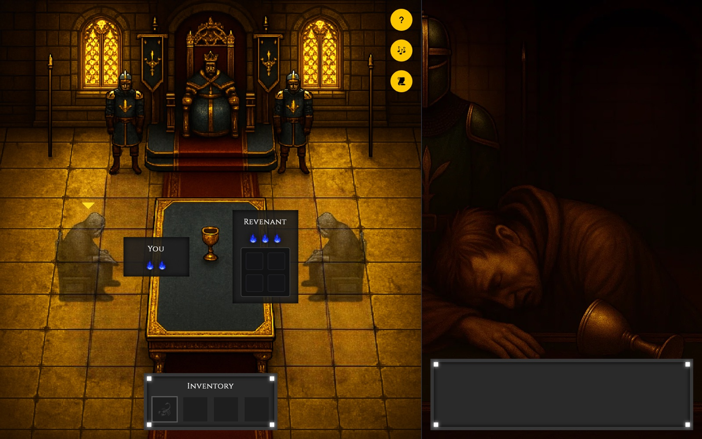 |
| **Join a room** | **Lobby** |
| 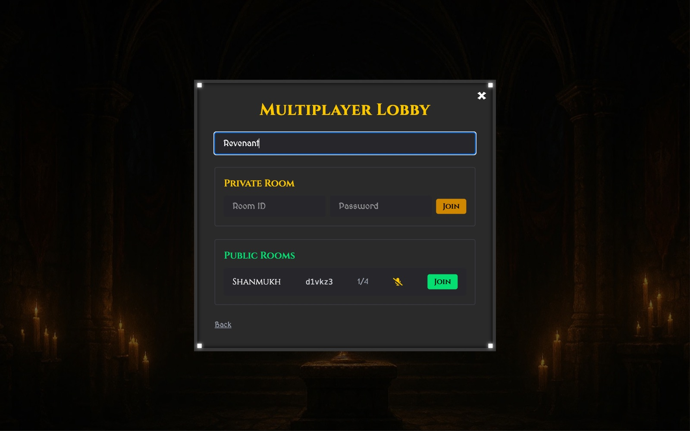 | 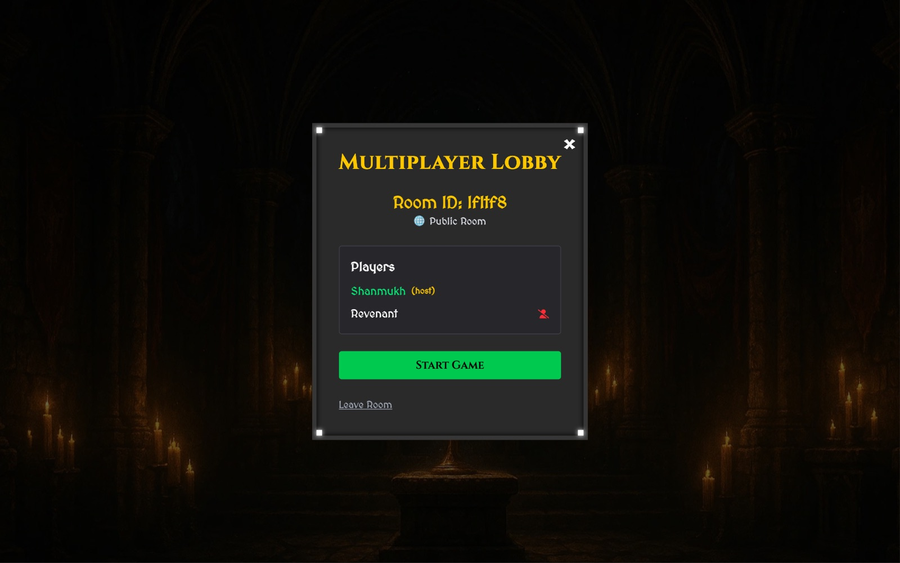 |
| **Multiplayer match** | **How to play** |
| 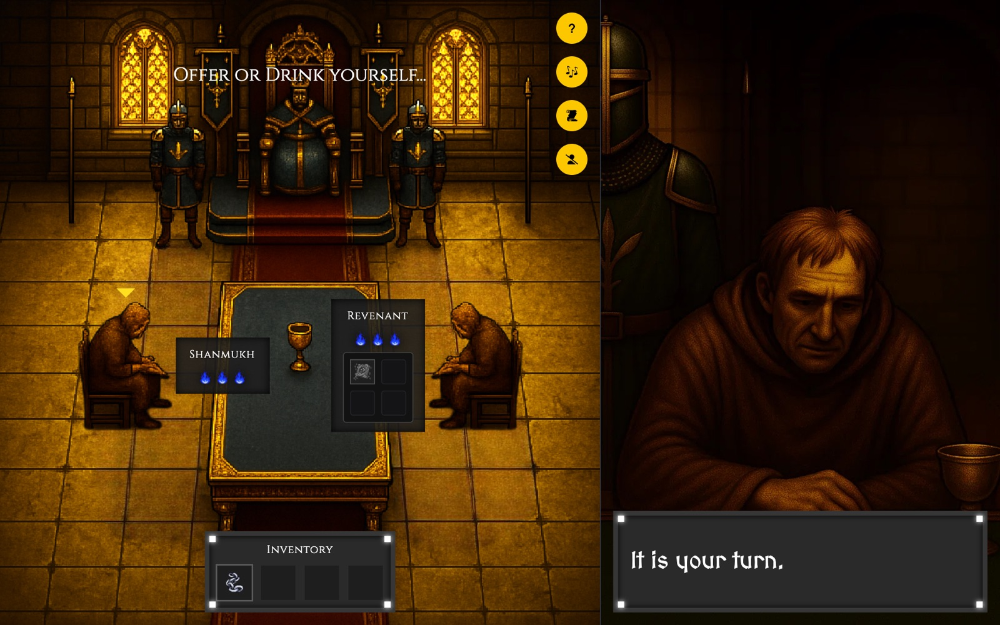 | 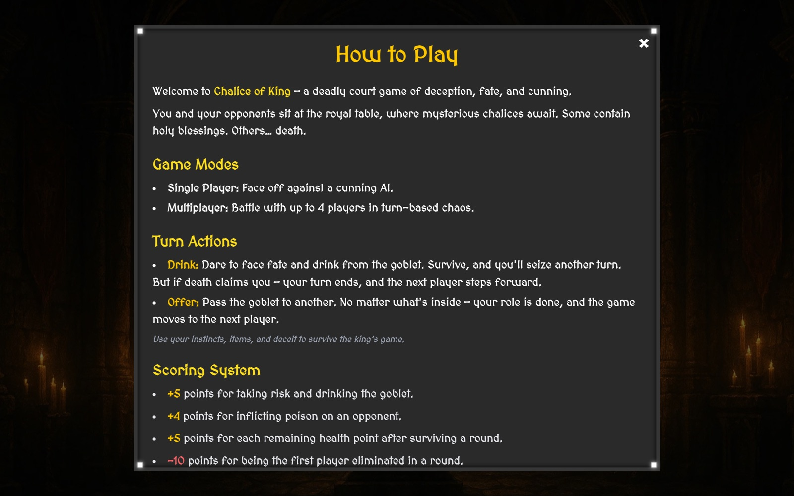 |
| **Game over** | **Credits** |
| 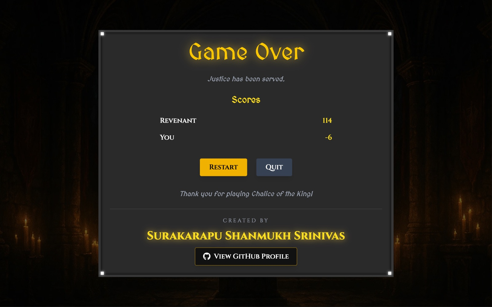 | 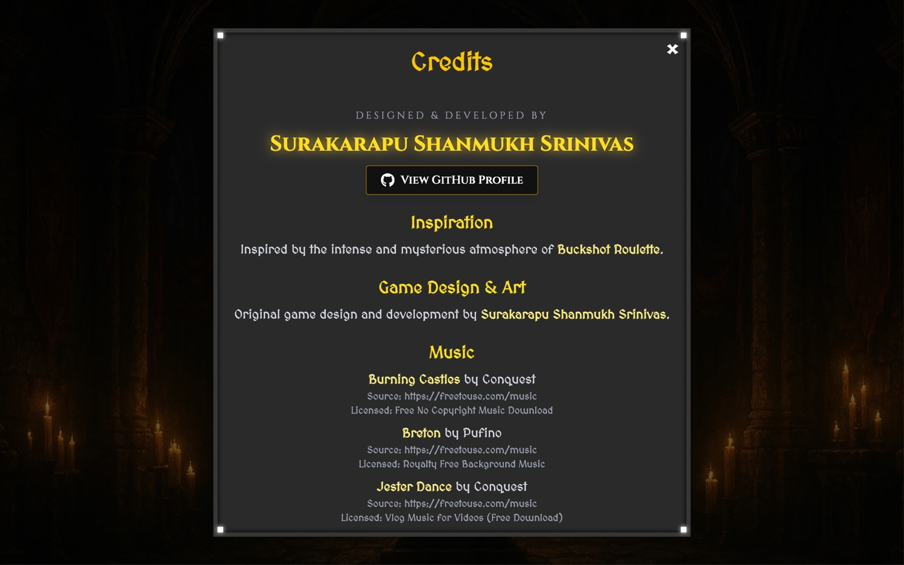 |

## Artifacts

| | Artifact | Effect |
| :---: | --- | --- |
| 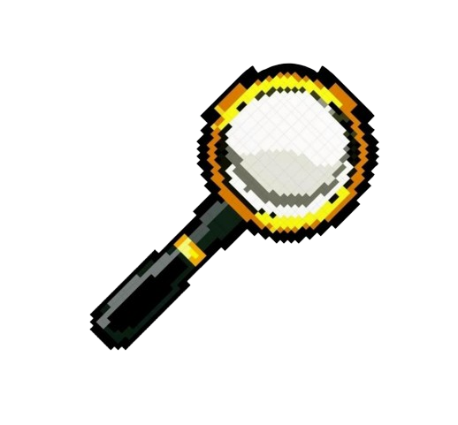 | Royal Scrutiny Glass | Reveal whether the current goblet is poisoned or holy. |
| 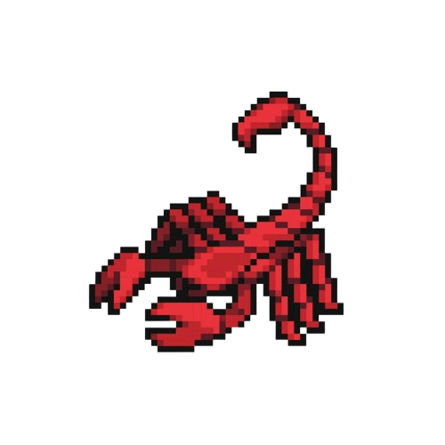 | Verdict Amplifier | Double the goblet's effect. |
| 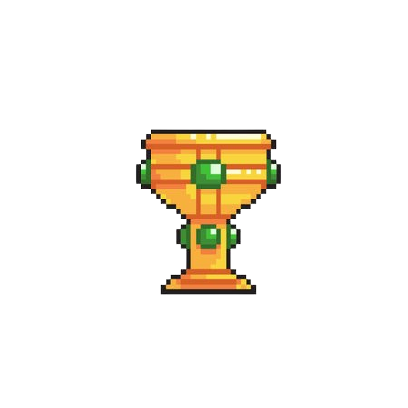 | Crown Disavowal | Discard the current goblet. |
| 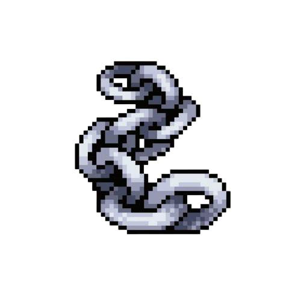 | Royal Chain Order | Make a player skip their next turn. |
| 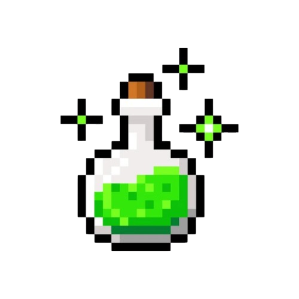 | Sovereign Potion | Restore 1 life. |
| 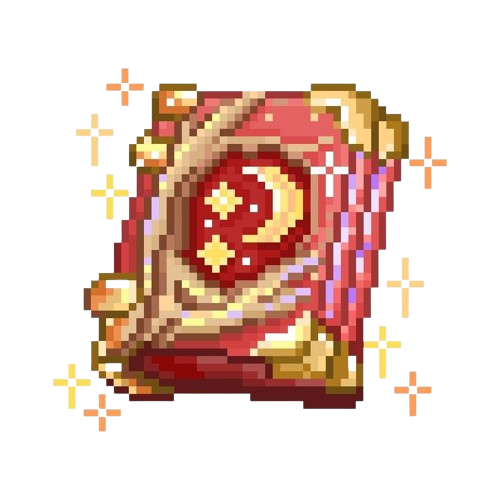 | Chronicle Ledger | Reveal a random upcoming goblet. |
| 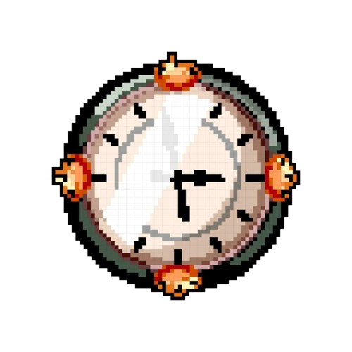 | Paradox Dial | Flip the current goblet between poison and holy. |
|  | Thief's Tooth | Steal an item from another player. |

## Scoring

| Event | Points |
| --- | :---: |
| Drinking the goblet yourself | +5 |
| Poisoning an opponent | +4 |
| Each remaining life after a round | +5 |
| First player eliminated in a round | −10 |

## Features

- **AI opponent:** weighs the odds from the remaining goblets and uses items. It runs in a Web Worker.
- **Real-time multiplayer:** 2–4 players, public or password-protected rooms, host controls.
- **Reconnection:** dropped players have 60 seconds to rejoin the same game.
- **Voice chat:** peer-to-peer WebRTC audio with per-player mute.
- **Interactive tutorial:** a guided first game.
- **Backend:** validated socket payloads, per-socket rate limiting, Redis-backed room state.

## Tech Stack

| Layer | Technology |
| --- | --- |
| Frontend | React 19, TypeScript, Vite, Tailwind CSS |
| Game engine | Shared TypeScript engine used by client and server |
| Realtime | Socket.IO with the Redis adapter |
| Voice | WebRTC |
| Backend | Node.js, Express, Zod, Winston |
| Data | Redis |
| Testing | Jest |
| Deployment | Vercel, Docker, Caddy, GitHub Container Registry |

## Architecture

```
React frontend  ◄── Socket.IO ──►  Node.js server  ◄──►  Redis
 (game UI, AI worker,               (rooms, turns,        (rooms, cache,
  shared engine)                     shared engine)        pub/sub)
        ▲
        └──── WebRTC voice (peer-to-peer) ────►  other players
```

Single player runs entirely in the browser. Multiplayer is server-authoritative: the backend runs the same game engine and broadcasts each state update to the room.

## Getting Started

### Docker

```bash
git clone https://github.com/shanmuckh/chalice-of-the-king.git
cd chalice-of-the-king
docker compose up -d --build
```

The game runs at http://localhost:8080 and the backend at http://localhost:3001/health.

### Development

Requires Node.js 20+ and Redis.

```bash
# Redis
docker compose -f docker-compose.dev.yml up -d

# Backend (http://localhost:3001)
cd backend && cp .env.example .env && npm install && npm run dev

# Frontend (http://localhost:5173), in a second terminal
cd frontend && npm install && npm run dev
```

### Tests

```bash
cd backend && npm test
cd frontend && npm run lint && npm run build
```

## Deployment

**Frontend (Vercel):** deploy the `frontend/` folder and set `VITE_SOCKET_URL` to the backend's public URL.

**Backend (Docker + Caddy):** build the image from the repository root, then run `./setup-ec2-backend.sh` on the server. The script writes `.env` and starts Redis, the backend and Caddy (automatic HTTPS) using `docker-compose.backend.yml`.

```bash
docker build -f backend/Dockerfile -t ghcr.io/<user>/chalice-backend:latest .
```

| Variable | Purpose |
| --- | --- |
| `FRONTEND_URL` | Allowed CORS origin(s), comma-separated |
| `DOMAIN` | Public backend domain for HTTPS |
| `REDIS_URL` | Redis connection string |
| `RATE_LIMIT_WINDOW_MS`, `RATE_LIMIT_MAX_REQUESTS` | Per-socket rate limit |

## Project Structure

```
frontend/   React client: pages, game UI, AI worker, assets
backend/    Socket.IO server: rooms, turns, reconnection, Redis persistence
shared/     Game engine, item system, AI logic and types
caddy/      Reverse-proxy config
docs/       Screenshots
```

## Credits

Designed and developed by **Surakarapu Shanmukh Srinivas** ([@shanmuckh](https://github.com/shanmuckh)).

Inspired by the atmosphere of *Buckshot Roulette*. Music is royalty-free from [freetouse.com](https://freetouse.com/music); the in-game Credits page lists every track.
